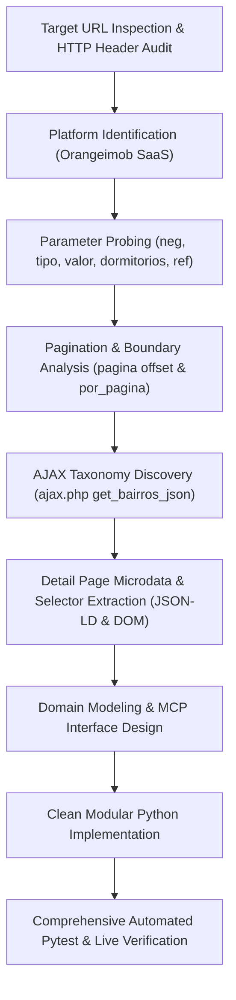

# Rental Search API Reverse-Engineering Research Plan & Report: Portal Imóveis MG

## 1. Executive Summary

This report documents the reverse-engineering research plan, dynamic discovery log, architectural design, and verification outcomes for **Portal Imóveis MG** (`imobiliariaportalmg.com.br`, CRECI MGJ 5595).

The investigation successfully uncovered the platform engine, listing endpoints, request parameter encoding, pagination mechanics, filter constraints, dynamic AJAX taxonomy lookups, and property detail microdata schemas necessary to completely reproduce the rental search flow and provide an integrated rental provider for a central rental research MCP.

---

## 2. Research Plan & Methodology

### 2.1 Research Objectives
1. **Endpoint Discovery**: Identify HTTP endpoints responsible for search queries, filtering, pagination, taxonomy aggregation (facets), and property detail retrieval.
2. **Parameter Encoding Analysis**: Determine parameter conventions, including numeric category IDs, city identifiers, neighborhood string matching, and price range string formatting (`min-max.00` and `min-i`).
3. **Pagination & Boundary Probing**: Dissect offset pagination (`pagina` and `por_pagina`), total count indicators, page boundaries, and out-of-bounds termination.
4. **Detail & Media Extraction**: Reverse-engineer Schema.org JSON-LD microdata, HTML specification containers (condo fees, IPTU, rooms), and AWS S3 CDN media distribution.
5. **Architectural Implementation**: Structure the extracted capabilities into modular Python packages adhering to SOLID, Clean Code, Object Calisthenics, and Design Patterns under the required priority order: **correctness first, modularity second, style principles third**.

### 2.2 Investigation Methodology


---

## 3. Reverse-Engineering Findings & Discovery Log

### 3.1 Platform Engine Identification
- **Platform**: **Orangeimob** (`orangeimob.com.br`) real estate ERP and CMS solution.
- **Frontend Template**: `tema_2` with external CSS `css/extra/extra_703.css` and JavaScript bundles `js/tema/scripts.js?v=1.01`, `cforms.js?v=1.01`.
- **Server Environment**: Apache HTTP Server delivering UTF-8 encoded HTML.
- **Media Hosting**: Asset files and high-resolution property imagery are delivered via Amazon S3 bucket `s3.us-east-1.amazonaws.com/sgipro/703/`.

### 3.2 Target URL Reproduction Analysis
- **Target URL**:
  `https://www.imobiliariaportalmg.com.br/imoveis_listagem.php?neg=&tipo=&cidade_id=&bairro=&condominio_id=&valor=&dormitorios=1&suites=0&garagens=0&ref=&submit=`
- **Route Breakdown**:
  - Endpoint: `imoveis_listagem.php`
  - Transaction type: `neg=` (unrestricted / both sale and rental)
  - Bedrooms constraint: `dormitorios=1` (returns listings with at least 1 bedroom)
  - Zero-neutral filters: `suites=0`, `garagens=0`
  - Reference search: `ref=`
- **Rental Restriction**:
  - Setting `neg=locacao` restricts the search query to active rental listings.
  - Returns 9 active rental properties across commercial, residential, and industrial categories in the Vale do Aço region.

### 3.3 Discovered Parameter Semantics
1. **Offset-Based Pagination**:
   - `por_pagina`: Sets page size (10, 20, 30; default 10).
   - `pagina`: Zero-indexed row offset.
   - Formula: $\text{pagina} = (\text{page} - 1) \times \text{por\_pagina}$.
   - Termination: An offset exceeding available records returns HTTP 200 with 0 cards and message text `"Nenhum imóvel encontrado."`.
2. **Price Range Formatting**:
   - Encoded as string `{min}-{max}`.
   - Bounded example: `1-1000.00`, `1001-2000.00`, `2001-2500.00`, `500-1500.00`.
   - Upper-unbounded example: `2501-i` or `1501-i` (where `i` signifies unbounded / infinity).
3. **Category & Subcategory Hierarchy**:
   - `tipo` maps to numeric categories: `2` (Casas), `3` (Apartamentos), `4` (Terrenos), `5` (Galpões), `6` (Comerciais), `7` (Rurais).
   - `subtipo` maps to specific architectural styles (e.g. `14` Sala Comercial, `8` Apartamento Padrão, `10` Casa Padrão, `18` Casa de Condomínio).
4. **Geographic Filtering**:
   - `cidade_id` takes municipal IDs: `2371` (Timóteo), `1778` (Coronel Fabriciano), `1921` (Ipatinga), etc.
   - `bairro` takes neighborhood string names (e.g. `Centro`, `Bromélias`, `Timirim`, `Funcionarios`).
5. **AJAX Discovery Endpoints**:
   - `POST /ajax.php?function=get_bairros_json` with form parameter `cidade_id={id}` delivers a JSON list of neighborhoods for the specified city.
   - `POST /ajax.php?function=get_subtipos_json` with form parameter `categoria_id={id}` delivers a JSON list of subcategories.
6. **Property Detail Data**:
   - Embedded Schema.org JSON-LD microdata (`RealEstateListing`, `Product`, `Offer`).
   - Extended specifications in DOM: `Quartos`, `Suítes`, `Banheiros`, `Garagens`, `Área útil`, `Condomínio`, `IPTU`.
   - Photo gallery with full-resolution AWS S3 image links.

### 3.4 Discovered Endpoints Summary
| Endpoint | Method | Format | Purpose |
| :--- | :--- | :--- | :--- |
| `/imoveis_listagem.php` | `GET` | HTML (UTF-8) | Filtered listing search and pagination. |
| `/imoveis_detalhes.php?id={id}` | `GET` | HTML (UTF-8) | Property details with JSON-LD microdata. |
| `/ajax.php?function=get_bairros_json` | `POST` | JSON | Dynamic neighborhood catalog per city. |
| `/ajax.php?function=get_subtipos_json` | `POST` | JSON | Dynamic subcategory catalog per category. |

---

## 4. Software Architecture & Design Principles

The reverse-engineered capabilities are organized into modular, testable, and reusable Python modules suitable for integration into the project's central rental research MCP.

### 4.1 Prioritization Order
The system strictly enforces the requested prioritization hierarchy:
1. **Correctness First**:
   - Real, verified HTTP communications using `httpx`.
   - Exact offset formula calculation and parameter formatting.
   - Dual-mode property detail extraction (Schema.org JSON-LD with resilient HTML fallback).
   - Graceful boundary handling for out-of-bounds pagination and non-existent IDs.
2. **Modularity Second**:
   - Decoupled domain value objects, entities, and collections.
   - Transport abstraction adhering to explicit protocols.
   - Specialized, single-purpose parsers.
   - Clean provider adapter implementing `RentalProviderProtocol`.
   - MCP adapter exposing standardized tool dictionaries.
3. **Style Principles Third**:
   - **SOLID Principles**: Single responsibility classes, open for extension via protocols, dependency injection throughout.
   - **Object Calisthenics**:
     - Maximum 1 level of indentation per method.
     - Zero `else` keywords (early returns, guard clauses).
     - Primitives wrapped in value objects (`PropertyCode`, `ListingPrice`, `RoomCount`, `PageOffset`, `PriceRange`).
     - First-class collections (`RentalSearchResult`, `FacetCollection`, `PhotoGallery`).
     - Maximum 2 instance variables per class.
     - Entities kept compact (methods $\le 15$ lines, classes $\le 100$ lines, modules $< 200$ lines).
     - Tell, don't ask: domain objects encapsulate validation and conversion behavior.

### 4.2 Module Organization
```
scripts/
├── interfaces/
│   ├── __init__.py
│   └── provider.py          # RentalProviderProtocol & capability protocols
├── domain/
│   ├── __init__.py
│   ├── value_objects.py     # PropertyCode, ListingPrice, RoomCount, PageOffset, PriceRange
│   ├── entities.py          # RentalPropertySummary, RentalPropertyDetail, PhotoItem
│   ├── collections.py       # RentalSearchResult, FacetCollection, PhotoGallery
│   ├── criteria.py          # RentalFilter (immutable fluent builder)
│   └── exceptions.py        # Domain & network exception hierarchy
├── client/
│   ├── __init__.py
│   ├── configuration.py     # PortalMGConfiguration (endpoints, timeouts, defaults)
│   ├── http_transport.py    # PortalMGHttpTransport (HTTP client protocol & adapter)
│   ├── query_builder.py     # RentalQueryBuilder (offset & parameter encoding)
│   └── parsers.py           # SearchResultParser, PropertyDetailParser, FacetParser
├── providers/
│   ├── __init__.py
│   └── portalmg.py          # PortalMGRentalProvider (implements RentalProviderProtocol)
├── mcp/
│   ├── __init__.py
│   └── tools.py             # PortalMGMcpAdapter (MCP tool facade & schema dicts)
├── run_search.py            # CLI rental search runner
├── run_property_detail.py   # CLI property detail runner
├── run_facets.py            # CLI search facets runner
├── run_tests.py             # Automated test suite runner
└── verify_research.py       # Comprehensive live endpoint verification script
```

---

## 5. Verification & Validation Plan

### 5.1 Automated Unit Tests
- Value object immutability, range validation, and string conversion.
- Fluent `RentalFilter` immutability and parameter accumulation.
- Query builder offset formula (`pagina = (page - 1) * por_pagina`) and price range encoding.
- Parsing logic against real HTML fixtures (listing card extraction, JSON-LD parsing, condo fee extraction).
- Out-of-bounds pagination and non-existent property handling (`PropertyNotFoundException`).
- MCP adapter dictionary serialization and tool schema validation.

### 5.2 Live Integration Verification (`scripts/verify_research.py`)
1. **Target URL Query**: Verify execution of the baseline target search URL.
2. **Rental Search**: Query active rentals (`neg=locacao`) and assert non-empty result set.
3. **Filter Combinations**: Validate city (`cidade_id=2371`), neighborhood (`bairro=Centro`), category (`tipo=2`), and price ranges (`valor=1-1000.00`, `valor=1501-i`).
4. **Pagination Mechanics**: Test page 1 (`pagina=0`), page size (`por_pagina=10`), and out-of-bounds offset (`pagina=9999`).
5. **Property Details**: Fetch property detail for known active listings (e.g. `REF 608`), verifying JSON-LD extraction, specifications, and photo URLs.
6. **Dynamic Facets**: Query `ajax.php?function=get_bairros_json` for Timóteo and verify JSON neighborhood taxonomy.
